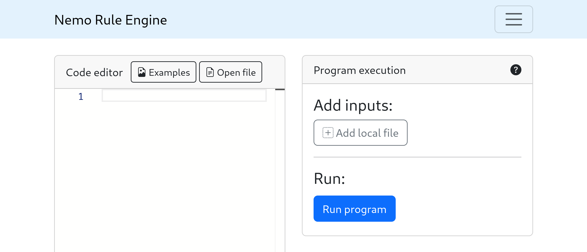

# Nemo Web IDE

[](https://gitter.im/nemo/community)

Interactive Web-Frontend for the Nemo Rule Engine/Reasoner.

</img>

This project uses:

- Web assembly to execute the Nemo Rule Engine which is written in Rust
- Web workers to perform heavy computation in the background (Nemo reasoning, Monaco editor)
- File system API for downloading reasoning results

## Development

The web app needs three build products that are not part of this repository:

- `nemoWASMBundler/`: the Nemo WebAssembly library. In a checkout of [Nemo](https://github.com/knowsys/nemo), run
  `wasm-pack build --release --target bundler --out-dir $PATH_TO_NEMO_WEB/nemoWASMBundler nemo-wasm`.
- `nemoVSIX/nemo.vsix`: the Nemo editor extension, which provides the language features of the editor.
  Package it in Nemo's `nemo-vscode` directory (see its README) and copy the `.vsix` to `nemoVSIX/nemo.vsix`.
- `public/ev/`: the proof explorer [nev](https://github.com/imldresden/nev).
  In a checkout of nev at the revision pinned in `flake.lock`, run `npm ci && npm run build` and copy `dist/` to `public/ev`.

With [Nix](https://nixos.org), `nix build .#nemo-web` builds all three and the web app.

Then start a development server:

```bash
npm ci
npm run dev
```

Before committing changes:

```bash
npm run lint
```

### Technologies used in this project

- Programming language: TypeScript
- Single page application framework: Vite
- Rendering: React.js
- State management: React.js and Redux
- Code editor: Monaco Editor

### Getting started

Useful starting points for hacking on the code:

- Implementation of the program execution panel: [src/components/executionPanel/ExecutionPanel.tsx](src/components/executionPanel/ExecutionPanel.tsx)
- Interaction with the Nemo web assembly API: [src/nemoWorker/NemoRunner.ts](src/nemoWorker/NemoRunner.ts)
- Example Nemo programs: [src/components/examples/files/listOfExamples.ts](src/components/examples/files/listOfExamples.ts)
- Nemo syntax highlighting and other language features come from the Nemo editor extension, loaded in [src/components/editor/createMonacoEditor.ts](src/components/editor/createMonacoEditor.ts)

## Production build

With the three build products from [Development](#development) in place, create a production build in the `dist` folder that can be served by a static web server:

```bash
npm ci
NODE_OPTIONS=--max_old_space_size=4096 npm run build

# for local preview of the production build
npm preview
```
